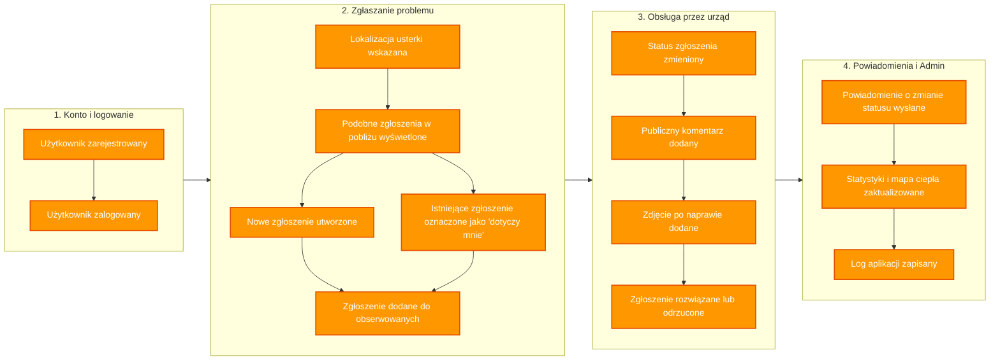
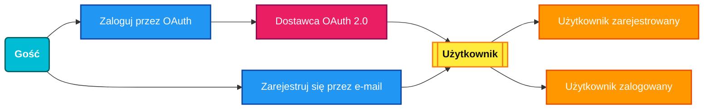
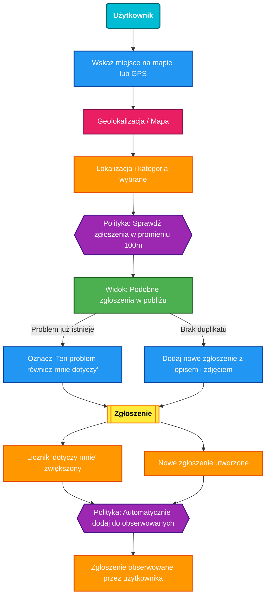
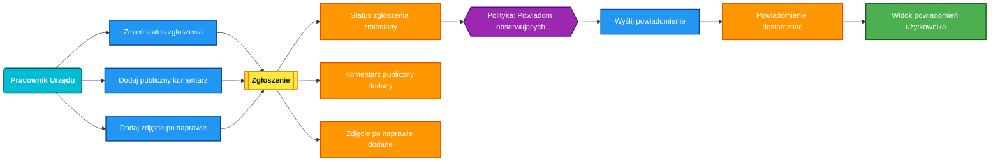
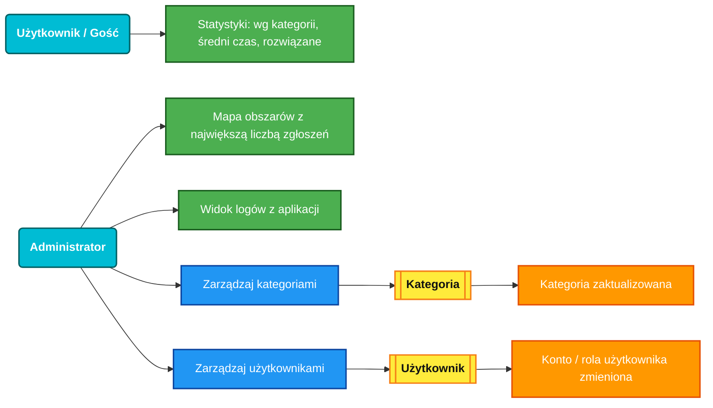

# Event Storming: HARNASIK

## 1. Cel dokumentu
Dokument przedstawia wynik sesji **Event Storming** dla systemu zgłaszania i obsługi usterek infrastruktury miejskiej. Model opisuje główne zdarzenia domenowe, komendy, aktorów, agregaty, polityki oraz systemy zewnętrzne zaangażowane w działanie aplikacji.

---

## 2. Legenda kolorów kafelków

Na wszystkich poniższych diagramach zastosowano rzeczywiste kolory karteczek:

| Kolor | Element | Opis |
| :--- | :--- | :--- |
| **Pomarańczowy** (`#FF9800`) | **Domain Event (Zdarzenie)** | Fakt, który wydarzył się w systemie (czas przeszły dokonany). |
| **Niebieski** (`#2196F3`) | **Command (Komenda)** | Akcja wywoływana przez aktora lub politykę (tryb rozkazujący). |
| **Turkusowy** (`#00BCD4`) | **Actor (Aktor)** | Rola użytkownika wykonującego komendę. |
| **Żółty** (`#FFEB3B`) | **Aggregate (Agregat)** | Obiekt domenowy przetwarzający komendy i generujący zdarzenia. |
| **Fioletowy** (`#9C27B0`) | **Policy (Polityka)** | Automatyczna reguła: *„Kiedy [Zdarzenie], wykonaj [Komenda]”*. |
| **Zielony** (`#4CAF50`) | **Read Model (Widok)** | Dane prezentowane użytkownikowi na ekranie przed podjęciem akcji. |
| **Różowy** (`#E91E63`) | **External System (System zewn.)** | Zewnętrzna usługa (OAuth 2.0, GPS, OpenStreetMap). |
| **Czerwony** (`#F44336`) | **Hot Spot (Problem / Pytanie)** | Wąskie gardło lub ryzyko wymagające decyzji. |

---

## 3. Aktorzy i Systemy Zewnętrzne

### Aktorzy:
* **Gość** – niezalogowany użytkownik (przegląda mapę zgłoszeń i publiczne statystyki, może się zarejestrować).
* **Użytkownik (Mieszkaniec)** – zalogowany użytkownik (zgłasza usterki, oznacza „ten problem również mnie dotyczy”, obserwuje zgłoszenia i otrzymuje powiadomienia).
* **Pracownik Urzędu** – obsługuje zgłoszenia (zmienia statusy, dodaje publiczne komentarze, dołącza zdjęcia po naprawie).
* **Administrator** – zarządza użytkownikami i kategoriami, przegląda mapę ciepła (obszary z największą liczbą zgłoszeń) oraz logi aplikacji.

### Systemy zewnętrzne:
* **Dostawca OAuth 2.0 (Google / GitHub)** – zewnętrzne uwierzytelnianie użytkowników.
* **OpenStreetMap + Leaflet** – dostawca map i wizualizacji przestrzennej.
* **Geolocation API (GPS)** – pobieranie bieżącej lokalizacji użytkownika.

---

## 4. Big Picture – Główne zdarzenia domenowe

---

## 5. Przepływy procesów (Process Modeling)

### 5.1. Rejestracja i logowanie (E-mail oraz OAuth)

### 5.2. Zgłaszanie usterki i sprawdzanie podobnych zgłoszeń w pobliżu

### 5.3. Obsługa zgłoszenia przez Pracownika Urzędu i powiadomienia

Dopuszczalne statusy zgłoszenia: `zgłoszone`, `przyjęte`, `przekazane do realizacji`, `w realizacji`, `rozwiązane`, `odrzucone`.

### 5.4. Statystyki publiczne i Panel Administratora

---

## 6. Zestawienie elementów modelu

### Agregaty (Żółte):
1. **Użytkownik (`User`)** – dane konta, metoda logowania (e-mail / OAuth), rola (`user`, `official`, `admin`).
2. **Zgłoszenie (`Issue`)** – współrzędne geograficzne, kategoria, opis, zdjęcia (przed i po naprawie), aktualny status, komentarze urzędowe, lista obserwujących oraz licznik „dotyczy mnie”.
3. **Kategoria (`Category`)** – nazwa (np. *uszkodzona latarnia*, *dziura w drodze*, *uszkodzony znak*, *śmieci*, *zniszczona ławka*), ikona, status aktywności.
4. **Log aplikacji (`SystemLog`)** – zapis zdarzeń systemowych i audytowych dla administratora.

### Modele odczytu / Widoki (Zielone):
* **Mapa zgłoszeń** – publiczna mapa wszystkich zgłoszonych problemów w mieście.
* **Podobne zgłoszenia w pobliżu** – lista otwartych zgłoszeń w promieniu geograficznym wyświetlana przed utworzeniem nowego zgłoszenia.
* **Szczegóły zgłoszenia** – opis, zdjęcia usterki, status, komentarze urzędowe, zdjęcie po naprawie.
* **Publiczne statystyki** – liczba zgłoszeń wg kategorii, średni czas realizacji, liczba rozwiązanych zgłoszeń.
* **Mapa ciepła (Heatmap)** – mapa dla administratora pokazująca obszary z największą liczbą zgłoszeń.
* **Rejestr logów** – tabela logów aplikacji w panelu administratora.

### Hot Spoty / Problemy rozwiązane podczas sesji (Czerwone):
1. **Wyszukiwanie zgłoszeń po odległości w SQLite:** SQLite nie ma domyślnie funkcji geograficznych PostGIS. **Rozwiązanie:** wstępne zawężenie wyników zapytaniem `BETWEEN` dla szerokości i długości geograficznej (*Bounding Box*), a następnie dokładne obliczenie odległości ze wzoru Haversine’a.
2. **Zapobieganie wielokrotnemu klikaniu „Ten problem również mnie dotyczy”:** **Rozwiązanie:** tabela pośrednia `issue_upvotes` z unikalnym kluczem złożonym `(issue_id, user_id)`.
3. **Obliczanie średniego czasu realizacji:** **Rozwiązanie:** zapisywanie daty `resolved_at` w momencie zmiany statusu na `rozwiązane`, co pozwala łatwo wyliczyć różnicę czasu od `created_at`.